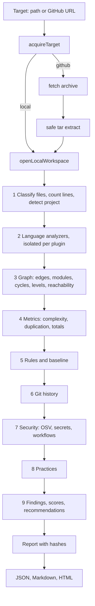

# Analysis pipeline (as built in Phase 1)

Entry point: `analyze(options)` in `packages/core/src/pipeline/analyze.ts`. Acquisition happens before it
(`acquireTarget`), so the pipeline only sees a bounded `Workspace`.

## Stages and failure behavior

| Stage | Output | If it fails |
|---|---|---|
| Acquire | Workspace (files, budgets, exclusions) | Error exit 3 |
| Classify and detect | FileRecord list, DetectionSummary | n/a (pure functions) |
| Analyzers | Dependencies, symbols, functions per file | The plugin is reported failed, its languages drop to Level 1, report is `partial` |
| Graph | GraphModel | n/a (pure) |
| Rules | Rule findings | Invalid rules file is a usage error before any work starts |
| History | HistorySummary | `available: false` with a reason |
| Security | Findings and per-check status | Each check is "not assessed" with a reason. OSV failure while online marks the report `partial` |
| Scoring | ScoreRecords | A dimension without enough inputs is "not assessed" |

## Determinism rules

Sorted traversal (files, edges, modules, findings), ids from content hashes, no wall clock inside findings,
`stableStringify` for hashes, the content hash excludes only the timestamps and itself. A test runs the same
repository created in a different file order and asserts the same hash.

## Module and graph rules

See ADR 0016. Graph nodes are production source files that an analyzer processed. Edges carry weight,
`typeOnly` and up to 10 occurrences with line numbers (the evidence for rule violations).

## Scoring flow

Sub-metric raw value, then a piecewise linear curve to 0 to 100, then the weighted mean over available inputs.
If less than half of the dimension weight is available the dimension is not assessed. Confidence is derived from
coverage (structural coverage and import resolution ratio for architecture). See scoring-methodology.md.

## Security boundaries inside the engine

The engine never spawns a process with repository content as the command. Child processes are limited to `git`
(hardened flags, fixed arguments, repository content only as data) and the optional `gitleaks` binary
(fixed arguments). Archive extraction never creates links or devices and never writes outside the destination.
