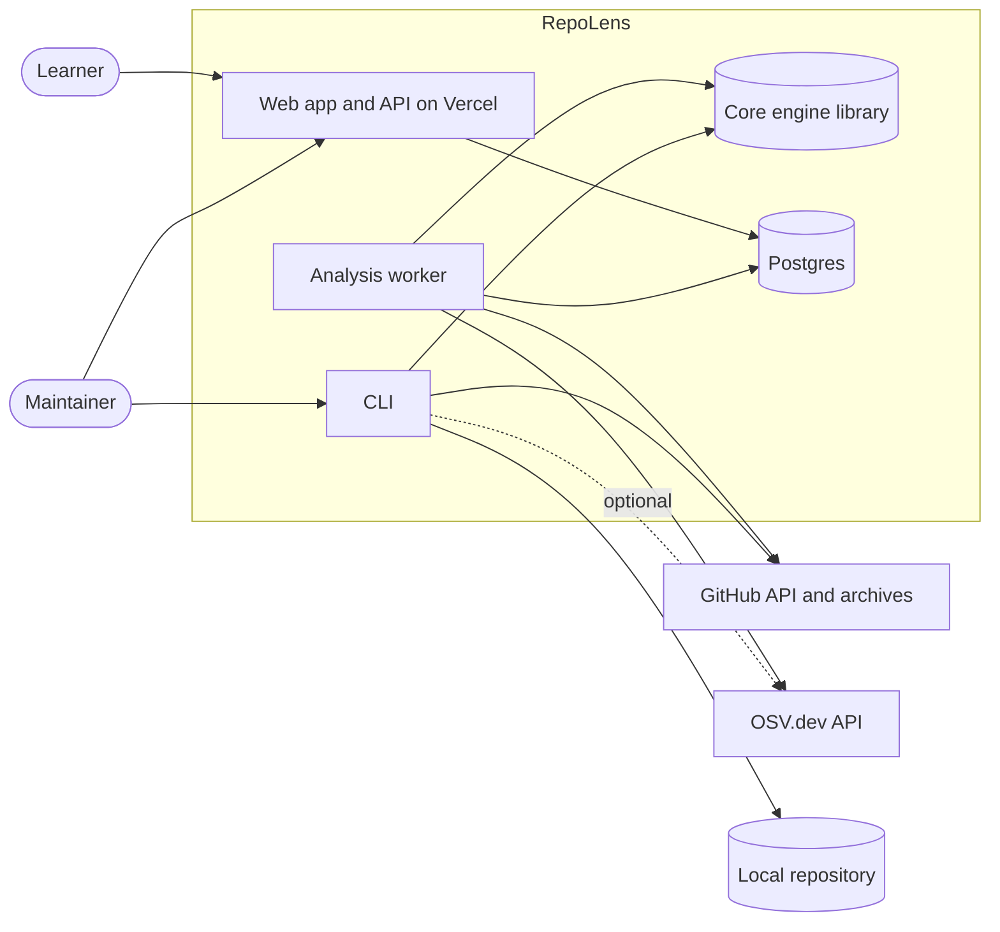
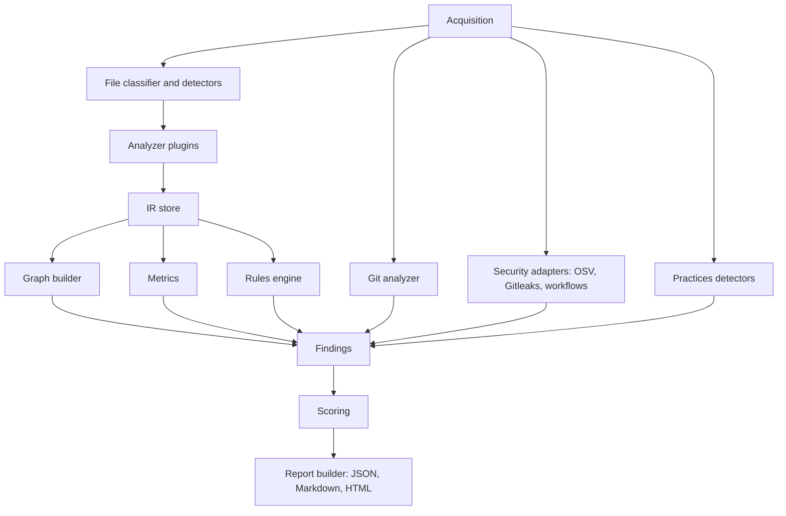

# Architecture overview

Status: Accepted by the owner, pending technical validation in Phase 1 and Phase 2 gates.

## 1. Chosen approach: local-first modular monolith (Option A)

A single TypeScript monorepo with a shared engine. The CLI runs the engine locally. The hosted site
is a viewer plus a thin API, and a separate worker runs the same engine for submitted public repositories.

### Alternatives considered

| Option | Summary | Verdict |
|---|---|---|
| A. TypeScript core, CLI, web, worker | One language, one schema, local-first | Chosen |
| B. Python core, TypeScript web | Strong analysis libraries, two languages, duplicated types, heavier CLI packaging | Rejected for a solo developer |
| C. All analysis in Vercel functions | Simplest hosting | Rejected: 300 s, 2 GB, 4.5 MB limits and unsafe for untrusted repos (verified facts V-01 to V-03) |

## 2. System context

## 3. Containers

| Container | Tech | Responsibility |
|---|---|---|
| apps/web | Next.js, TypeScript | UI, thin API routes (validate, enqueue, read), report viewing |
| worker | Node, TypeScript, pg-boss | Pull jobs, acquire repo, run the engine, store the report, enforce budgets |
| packages/core | TypeScript library | Acquisition, analyzers, IR, graph, metrics, rules, scoring, report generation |
| packages/cli | TypeScript, Node | Commands, flags, exit codes, progress, local and remote analysis |
| Postgres | Managed free tier, local via Docker | Jobs, reports (JSONB), history, rule sets, rate limit counters |

## 4. Core engine components

Boundaries:

- Analyzers depend on the IR interfaces, never the other way round (dependency inversion).
- Each analyzer runs isolated: failure produces a coverage gap and a limitation, not a crash.
- Security adapters call external tools through a narrow interface that returns normalized findings.
- Report builders consume only the final report model.
- The web app consumes only the versioned report JSON and API contracts, never engine internals.

## 5. Data flow (hosted)

1. User submits URL. API validates and normalizes it (SSRF safe, GitHub hosts only for the MVP), creates a job row, returns a job id.
2. Worker claims the job, fetches the archive with size caps, extracts safely into an ephemeral workspace, runs the engine with budgets.
3. Worker streams stage progress into the job row. UI polls (server-sent events are Later).
4. Worker stores the report JSON and deletes the workspace.
5. UI reads the report and renders views. Export routes render Markdown and HTML from the stored report.

## 6. Technology stack (Proposed defaults, accepted)

| Layer | Choice | ADR |
|---|---|---|
| Language | TypeScript strict, Node 22 | 0001 |
| Monorepo | pnpm workspaces | 0001 |
| Parsing | TypeScript compiler API for JS/TS, Tree-sitter for Python and generic syntax | 0004 |
| Schema | Zod models with generated JSON Schema | 0005 |
| Queue and DB | Postgres, pg-boss, Drizzle ORM | 0006 |
| Web | Next.js App Router, CSS variables for tokens, Radix primitives | 0009 |
| Graph UI | To be decided at gate P2-01 (Cytoscape.js or Sigma.js with ELK layout) | 0012 |
| Security tools | OSV, Gitleaks | 0008 |
| Tests | Vitest, Playwright, axe | 0014 |
| Lint and format | Biome | 0014 |
| License | Apache-2.0 | 0010 |

## 7. Support levels (validated and adjusted)

The five levels from the prompt are kept, with one addition: each language reports its coverage.

| Level | Meaning | MVP languages |
|---|---|---|
| 1 | Detection, LOC, file classification | All |
| 2 | Syntax and import extraction | Python (stretch to 3), JS/TS |
| 3 | Symbols, resolved dependency graph | JS/TS |
| 4 | Semantic analysis, call graphs | None in MVP |
| 5 | Framework-specific architecture | None in MVP (Next.js conventions as Later) |

Each analyzer declares its level, features, known limitations, and fixture accuracy in its manifest.

## 8. Observed, inferred, documented

Every architecture statement in the IR carries an `origin`:

| Origin | Meaning | Example |
|---|---|---|
| observed | Directly extracted | File A imports file B at line 12 |
| inferred | Derived by heuristic, with a confidence and rule id | Module looks like a service layer |
| documented | From an ADR or doc with a source reference | ADR says API depends on domain |

The UI shows the origin on every architecture element. Intent is only claimed when documented.

## 9. Cross-cutting concerns

| Concern | Approach |
|---|---|
| Determinism | Sorted traversal, stable ids from content hashes and paths, no wall-clock in findings |
| Versioning | Report schema semver, additive within major, migration notes in the changelog |
| Errors and partial results | Per-analyzer try boundary, coverage records, `partial` status |
| Budgets | Wall time, file count, total bytes, per-file bytes, memory guard, graph size caps |
| Cancellation | AbortSignal passed through the pipeline, worker checks between stages |
| Retries and idempotency | Job id as idempotency key, at most 2 retries for transient acquisition errors only |
| Logging | Structured JSON logs, secret redaction, correlation id per job |
| Config | Layered: defaults, profile file, repository `repolens.config.yaml`, CLI flags, with a resolved config hash stored in the report |
| Migrations | Drizzle migrations in the repo, applied by a deploy step, rollback notes per migration |
