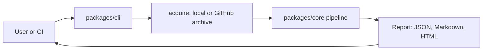

# Learning: Phase 1, the analysis engine and the CLI

Read this slowly. It explains what was built, why, where each piece lives, how the algorithms work, what went wrong
while building (that is where the real learning is), and what the limits are. A question bank is at the end.

## 1. What Phase 1 delivers in one paragraph

A command line tool, `repolens analyze <folder or GitHub URL>`, that safely reads a repository, figures out its
languages and project type, extracts the import dependencies between files, builds a dependency graph and finds
circular dependencies, measures size, complexity and duplication, checks your architecture rules, reads Git history to
find risky files, looks for known security signals, inspects practices such as CI and documentation, turns everything
into scored findings with evidence, and writes a JSON, Markdown and HTML report. Everything is deterministic, offline
capable, and tested against hand-built repositories with known answers.

## 2. Where everything lives

| Folder (under `packages/core/src`) | Job | Key files |
|---|---|---|
| `util` | Hashing, globs, path safety. Depends on nothing | `hash.ts`, `glob.ts`, `paths.ts` |
| `ir` | The data model (types) and the report JSON Schema plus validator | `types.ts`, `schema.ts` |
| `config` | Layered configuration with validation and a hash | `config.ts` |
| `acquire` | Get files safely: local walk, safe tar extraction, GitHub URL and download | `local.ts`, `tar.ts`, `github.ts` |
| `detect` | Languages, file kinds, manifests, frameworks, entrypoints | `classify.ts`, `manifests.ts`, `languages.ts` |
| `analyzers` | Language plugins: JS/TS, Python | `js-ts.ts`, `python.ts`, `registry.ts`, `types.ts` |
| `graph` | Dependency graph, modules, cycles | `build.ts`, `scc.ts` |
| `metrics` | Line counts, duplication | `loc.ts`, `duplication.ts` |
| `rules` | Architecture rules language, evaluation, baseline | `engine.ts`, `yaml.ts` |
| `git` | History, hotspots, ownership, hardened Git calls | `history.ts` |
| `security` | OSV, secrets, GitHub Actions checks | `osv.ts`, `secrets.ts`, `workflows.ts` |
| `practices` | CI, tests, lint, docs detection | `detect.ts` |
| `findings` | Turn facts into findings | `generate.ts`, `make.ts` |
| `scoring` | Scores, recommendations | `profile.ts`, `score.ts`, `recommend.ts` |
| `report` | Markdown, HTML, comparison of two reports | `markdown.ts`, `html.ts`, `diff.ts` |
| `pipeline` | Orchestrates all stages | `analyze.ts`, `target.ts` |
| `eval` | Accuracy harness over fixtures | `harness.ts`, `run.ts` |

Other places: `packages/cli/src/main.ts` (commands), `fixtures/` (ground truth repositories), `repolens.rules.yaml` (this
repository's own architecture rules), `scripts/benchmark.mjs`, `docs/reference` (CLI, rules, analyzers).

## 3. Concepts walkthrough (what, why, how, limits)

### 3.1 Safe acquisition (`acquire`)
- **What:** reads files from a folder, or downloads a GitHub archive and unpacks it.
- **Why:** a repository is untrusted input. A hostile archive can write outside the folder (`../../etc/x`), contain links to
  secrets, or expand from 1 MB to gigabytes (a decompression bomb).
- **How:** `tar.ts` is our own tar reader. It rejects absolute and `..` paths, skips symbolic links, hard links and device
  files, limits compressed size, expanded size (using Node's `maxOutputLength` while decompressing), file count and per-file
  size, strips the single root directory GitHub adds, and writes files with the exclusive-create flag so nothing is
  overwritten. `github.ts` accepts only `https://github.com/owner/repo` (no credentials, ports, IP addresses or other hosts), follows
  redirects manually only to `api.github.com` or `codeload.github.com`, and never forwards the token to another host.
  `local.ts` walks in sorted order, never follows symlinks, skips `node_modules` and `.git` and records why.
- **Limits:** budgets can truncate large repositories, and the report then says it is partial.

### 3.2 Classifying files (`detect`)
Path rules decide whether a file is source, test, config, docs, generated, vendored or binary, with the reason stored. Content
markers such as `@generated` demote generated code. Why: tests and generated code must not pollute architecture metrics.
A bug found here: patterns like `dist/**` matched only a top-level `dist`, not `packages/core/dist`. Fixed to `**/dist/**`.

### 3.3 The analyzer plugin architecture (`analyzers`)
Each language is a plugin with an id, version, languages, support level, capabilities and limitations, and one method:
`analyze(context)`. The pipeline runs plugins in isolation: if one throws, the report becomes partial and that language falls
back to Level 1. Adding a language means adding one file and one line in `registry.ts`. This is the Strategy pattern plus
dependency inversion (the pipeline depends on the interface).

Support levels: 1 detection and line counts, 2 syntax and imports, 3 resolved graph and symbols, 4 semantics (not built),
5 framework specific (not built). Every report states the level per language.

### 3.4 JavaScript and TypeScript analysis (`analyzers/js-ts.ts`)
- **Parsing:** the TypeScript compiler API turns source text into an abstract syntax tree (AST). We read it, never run it.
- **Imports found:** `import`, `import type`, `export ... from`, `require()`, `import()` with a literal, and `import("x").T`
  in types. Imports that are only types are marked `type-only`.
- **Resolution:** the hard part. Given `"@app/feature/a"` we need the file it means. We give the real TypeScript module resolver
  an in-memory view of the repository (so no node_modules, no disk access) and the nearest `tsconfig.json` (paths, baseUrl).
  We add workspace package resolution for monorepos (package name to its folder, mapping `dist` entries back to `src`).
  Results: resolved, external (a package or Node built-in), unresolved (with a reason) or ignored (URLs).
- **Complexity:** cyclomatic complexity = 1 + number of decision points (if, loops, case, catch, ternary, `&&`, `||`, `??`) per function.
  Nested functions are counted separately.
- **Why not regular expressions?** Regexes cannot handle comments, strings, template literals, aliases or `.js` to `.ts` mapping reliably.
- **Limits:** generated files not in the repository, tsconfig `extends` to outside packages, framework routing conventions,
  non-literal dynamic imports (counted and reported, not guessed).

### 3.5 Python analysis (`analyzers/python.ts`)
A lexical analyzer: first blank out strings and comments (so an `import` inside a docstring is ignored), then parse `import` and
`from x import y`, including multi-line parentheses and aliases. Resolution infers source roots from `__init__.py` layout,
resolves relative imports by dots, links `from pkg import name` to the submodule file if it exists, and treats the standard library as
built-in external. Level 2 because we do not build a real Python AST. Complexity is approximated from keywords and labeled so.
Honest deviation from the original plan: ADR 0004 said Tree-sitter for Python. We shipped a lexical parser because it is dependency
free and testable here. Tree-sitter remains the plan for more languages.

### 3.6 The dependency graph (`graph`)
- **Nodes** are production source files analyzed by a plugin. **Edges** are resolved imports between them, with a weight, a
  type-only flag and up to 10 occurrences (line numbers) as evidence.
- **Modules** are groups of files inferred from directories (ADR 0016): nearest package folder + optional `src` + one directory level.
  Always labeled as inferred from directories, not as the architect's intent.
- **Cycles:** Tarjan's strongly connected components algorithm, written iteratively so a 50,000-file chain does not overflow the
  stack (there is a test for exactly that). A cycle is a group of files that can all reach each other. We also record whether the cycle
  disappears when type-only imports are ignored (`typeOnly`).
- **Coupling metrics:** fan-in (who depends on me), fan-out (who I depend on), and Robert Martin's instability
  `I = Ce / (Ca + Ce)` (0 stable, 1 unstable). Instability is shown as a number, null when a module has no edges (not zero).
- **Levels:** collapse cycles, then level 0 = depends on nothing, higher levels depend on lower ones. Marked inferred, low or medium
  confidence.
- **Reachability:** from detected entrypoints we find files not reachable and with no importers. This is only a dead-code *signal*
  with low confidence, because frameworks load files by convention.
- **Resolution ratio:** resolved internal imports divided by all internal imports. It is the key reliability number for the graph.

### 3.7 Metrics (`metrics`)
- **Lines of code:** a small state machine that understands comments, strings and template literals, and splits lines into code,
  comment and blank. A `//` inside a string is not a comment.
- **Duplication:** normalize lines (trim, collapse spaces, drop comments and brace-only lines), hash every window of N consecutive
  lines (default 8, at least 120 characters), group equal windows, extend matches, and report duplicated lines divided by all lines.
  Limit: it finds copy-paste, not clones with renamed variables.

### 3.8 Architecture rules (`rules`)
A tiny language: layers (named glob groups) and five rule types: forbid dependency, allow only, forbid external package, no cycles,
limits. Parsed from a documented YAML subset by our own parser (no anchors or tags, which removes a class of YAML attacks). Violations
are findings with the import line as evidence and stable ids. A **baseline** lists accepted finding ids so a legacy project only fails on
new violations. The CLI returns exit code 1 on violations. This repository checks itself with `repolens.rules.yaml` in CI.

### 3.9 Git history (`git`)
Runs `git log --numstat` with fixed arguments and hardening flags (no hooks, no fsmonitor, no credential helper, no pager).
A test proves the attack is real (a hostile `core.fsmonitor` program runs with plain git) and is neutralized by our flags.
Outputs: contributors, top author share, hotspots, module ownership. **Hotspot** = file that is both frequently changed and
complex, scored as the product of two percentiles (commit count and max function complexity). **Ownership concentration** is a
continuity signal, never a quality score. Limits are stated: renames are not followed, squash merges hide authors, shallow clones
are incomplete, `maxCommits` caps the window.

### 3.10 Security signals (`security`)
- **Dependencies (OSV):** read pinned versions from `package-lock.json`, `yarn.lock`, `pnpm-lock.yaml`, `requirements.txt`, `poetry.lock`,
  query the OSV database (batch API) and make findings classified `confirmed` (the vulnerable version is present) with the explicit limitation
  that reachability is not assessed. Offline or failure means "not assessed", never zero.
- **Secrets:** a built-in set of high precision token formats (cloud keys, tokens, private key headers) plus optional Gitleaks if installed. The matched
  value is never stored.
- **GitHub Actions workflows:** unpinned actions, script injection through `${{ github.event... }}` in `run:`, `pull_request_target` checking out
  pull request code, missing or `write-all` permissions.
- **Statement:** every report says these are signals and do not show that a repository is secure.

### 3.11 Practices (`practices`)
Facts from files: CI providers, test frameworks, linters, formatters, type checkers (and whether TypeScript is strict), README sections, governance
files, decision records, setup aids. Neutral wording: absence in the repository root is not proof of absence elsewhere.

### 3.12 Findings, scores and recommendations (`findings`, `scoring`)
- A **finding** has a stable id, severity, confidence, origin (observed, inferred, documented), explanation from a template, evidence, locations,
  remediation and limitations.
- A **score** per dimension (architecture, maintainability, security hygiene, testing and CI, documentation, maintenance activity) is the weighted
  mean of sub-metrics. Each sub-metric maps a raw value through a piecewise linear curve to 0 to 100. If less than half of the weight is available the
  dimension is **not assessed** with a reason. Every score lists its inputs. There is deliberately no single overall score.
- **Confidence** comes from coverage (analyzed share, import resolution ratio) and is high, medium or low.
- **Recommendations** group findings by rule and rank by severity weight times confidence weight plus a small term for count.

### 3.13 Reports (`report`, `ir`)
- **JSON:** validated against a published JSON Schema (version 0.1.0) before it is written. The schema is the contract for the future web app.
- **Markdown** and **HTML:** HTML is one self-contained file with no scripts, a strict Content Security Policy, and every value escaped. Markdown
  neutralizes embedded HTML in untrusted text.
- **Reproducibility:** report stores tool and schema versions, config hash, scoring profile hash, commit, an input digest over file contents, and a content
  hash. Two runs on the same input have the same content hash (tested, including a different file creation order).
- **diff:** compares two reports (new and resolved findings, added and removed edges and modules, score deltas).

### 3.14 The CLI (`packages/cli`)
Commands `analyze`, `report`, `diff`, `schema`. Uses Node's built-in `parseArgs` (no dependency). Exit codes: 0 ok, 1 policy failure, 2 usage, 3 analysis
error, 4 partial with `--fail-on-partial`. `runCli` takes an I/O object so it is unit tested without spawning processes.

### 3.15 Testing and evaluation
- **165 automated tests** (unit, integration, security, determinism, CLI). Source is about 5,600 lines, tests about 1,700.
- **Fixtures** (`fixtures/`): 11 tiny repositories with `expected.json` ground truth written by hand. The harness computes precision and recall for
  edges, externals, unresolved imports and cycles. Current result: 1.0 on all categories. This proves the mechanisms on known cases. It is **not** a claim
  about accuracy on arbitrary repositories, because the fixtures are small and written by the same author.
- **Dogfooding:** the tool analyzes this repository in CI with its own rules.
- **Honesty about verification here:** the code was typechecked with the TypeScript compiler 6.0.3 and tests ran on Node 22. The tests ran under a small
  compatibility shim for the Vitest functions used, because Vitest and Biome could not be installed in the build environment. Your first `pnpm check`
  runs the real Vitest and Biome. Live OSV, Gitleaks and GitHub downloads were not exercised against real services here.

## 4. Architecture vocabulary you should be able to use

| Term | Where it applies |
|---|---|
| Modular monolith | One deployable core with enforced internal module boundaries |
| Pipeline (pipes and filters) | `analyze()` stages, each takes the previous outputs |
| Plugin / strategy | Language analyzers |
| Dependency inversion | Pipeline depends on the `AnalyzerPlugin` interface, not on concrete analyzers |
| Layered architecture | `util` below `ir` below the rest, enforced by our rules |
| Ports and adapters (light) | Git, Gitleaks, OSV behind narrow functions returning normalized findings |
| Local-first | CLI works offline on your machine |
| Immutable, deterministic outputs | Sorted traversal, stable ids, content hash |
| Defense in depth | Safe extraction, URL validation, hardened Git, escaped reports, no code execution |

## 5. Why these tools

| Choice | Reason |
|---|---|
| pnpm | Strict, fast, lockfile, workspaces. Stops phantom dependencies |
| Monorepo | Shared code and atomic changes for engine, CLI, web, worker |
| TypeScript strict | Safer refactors. Also gives the compiler API we use |
| Node 22 | LTS, built-in fetch and parseArgs |
| Biome | One tool for lint and format |
| Vitest | Fast TypeScript tests |
| Mermaid in docs | Diagrams versioned with the code |
| Hand-written validator and YAML subset | Fewer dependencies, no unsafe YAML features (ADR 0015) |

## 6. What went wrong and what we learned (real events)

1. **Our own report found real problems in our own repo.** Build output in nested `dist/` folders was analyzed as source (glob bug), and a module cycle existed
   because a config file and the barrel `index.ts` shared a directory. We fixed the glob and moved config into its own folder. Lesson: dogfooding is the cheapest test.
2. **Mistakes in the ground truth, not the tool.** Four fixtures forgot that `src/index.ts` and `main.go` are detected as entrypoints by convention. The evaluation caught it.
   Lesson: ground truth can be wrong too, so review disagreements before blaming the tool.
3. **A hash that ignored content.** The content hash did not change when a file changed in a way that kept all metrics identical. We added an `inputDigest` over file contents.
4. **Abort not propagated.** An already-aborted signal was not passed to analyzers. A test caught it.
5. **Markdown can carry HTML.** Untrusted names in Markdown reports could inject markup in viewers, so text is now neutralized.
6. **Test expectations can be wrong.** A Python test expected a missing submodule to resolve. The documented behavior is "unresolved". We fixed the test.
7. **Scores can be honest by being absent.** Offline, security hygiene is "not assessed" because too few inputs exist. We tested this instead of forcing a number.

## 7. Known gaps (say these before the examiner does)

- JS/TS and Python only. No call graph, data flow or taint analysis. Python is Level 2.
- Scores use provisional curves and are not calibrated on a large sample.
- Accuracy numbers come from small author-built fixtures. Real repository benchmarks and the comparison against dependency-cruiser and Madge (gate P1-01) are pending owner tasks.
- No coverage report ingestion, license compatibility check or incremental cache.
- Hosted private repository analysis is out of scope. Account-wide analysis is deferred.
- Complexity of some of our own functions is high (the tool flags `analyze`, `computeScores`, `generateFindings`). Refactoring them is planned technical debt.

## 8. Glossary

AST, abstract syntax tree. SCC, strongly connected component. Fan-in and fan-out, incoming and outgoing dependencies. Instability, `Ce/(Ca+Ce)`. Cyclomatic
complexity, number of independent paths through a function. Hotspot, frequently changed and complex file. Baseline, accepted findings to ignore. Support level, how deeply a
language is analyzed. Coverage, share of eligible files analyzed. Confidence, how reliable a conclusion is given coverage. SSRF, server side request forgery. SBOM, software bill of
materials. Idempotent, same input gives same result. Dogfooding, using your own tool on itself.

## 9. College questions and answers (Phase 1)

**1. Explain the architecture of the engine.** A pipeline of pure stages over a bounded workspace: classify, analyze with language plugins, build the graph, compute metrics,
evaluate rules, read Git history, run security checks, detect practices, generate findings, score, render. Plugins implement one interface so languages can be added without
changing the pipeline.

**2. How do you extract dependencies from JavaScript accurately?** With the TypeScript compiler API. It parses to an AST, so comments and strings cannot cause false matches. For
resolution we give the real module resolver the repository files and tsconfig, and add workspace package resolution. We measure the resolution ratio and report it.

**3. What happens when an import cannot be resolved?** It is recorded as unresolved with a reason (or external if it is a third-party package). The ratio lowers confidence and a
finding appears when more than 5 percent of internal imports are unresolved.

**4. Explain Tarjan's algorithm and why you made it iterative.** It finds strongly connected components in linear time using discovery indexes and low-link values with a stack.
Recursion depth equals the longest path, so a long chain overflows the call stack. The iterative version uses an explicit stack. A test uses a 50,000-node cycle.

**5. What is a circular dependency and why does it matter?** A set of modules that depend on each other directly or indirectly. They cannot be understood, tested or released
separately and changes ripple. We also tell you if a cycle is only type-level.

**6. What is instability?** `Ce / (Ca + Ce)`. A module with many outgoing and few incoming dependencies is unstable (changes elsewhere break it). It is a design heuristic, not a verdict.

**7. How do you infer modules and why is it labeled "inferred"?** From directory layout (ADR 0016). We cannot know the architect's intent. The origin field says observed, inferred or documented
so the UI never presents a guess as a fact.

**8. How is cyclomatic complexity calculated?** 1 plus the number of decision points in the function, not counting nested functions. For JS/TS from the AST. For Python it is approximated from
keywords and labeled approximate.

**9. How does duplicate detection work and what can it miss?** Window hashing over normalized lines. It finds copy-paste blocks and misses clones with renamed identifiers or reordered statements.

**10. How do you handle huge repositories?** Budgets on files, total bytes, per-file size and time. The walk stops, the report becomes partial and a finding explains it. `--fail-on-partial` makes CI fail on it.

**11. How do you protect against a malicious repository?** We never execute its code. Safe archive extraction, no links, size and count limits, strict GitHub URL validation, redirects only to
allow-listed hosts, hardened Git flags, secrets never stored, HTML reports without scripts and with a CSP. Each has a test.

**12. What is a decompression bomb and how do you stop it?** A tiny archive that expands to huge size. We pass `maxOutputLength` to the decompressor so it fails as soon as the limit is exceeded, and also
check the sum of extracted bytes.

**13. What is SSRF and how does your URL parser prevent it?** Tricking a server into requesting internal addresses. We accept only https `github.com`, no credentials, ports or IP hosts, and our download
refuses redirects outside two GitHub hosts. A test table covers metadata IPs, localhost, other hosts and non-http schemes.

**14. Why do you disable Git config like fsmonitor?** A repository's own `.git/config` can name a program Git will run (fsmonitor is one). A test proves plain git runs it and our hardened git does not.

**15. Is your tool deterministic? Prove it.** Yes. Sorted traversal, hashed ids, no clock in findings. A test analyzes the same repository created in a different file order and compares content hashes.

**16. How do you score a repository and why no single number?** Weighted sub-metrics through documented curves per dimension, with coverage and confidence. A single number hides which parts were
measured and invites false comparisons.

**17. What does "not assessed" mean and why does it matter?** The inputs were not available (for example offline vulnerability lookups). Showing zero would claim "no problems" or "perfect", which is false. We test this.

**18. How do you evaluate accuracy?** Fixtures with hand-written ground truth, precision and recall per category, and exact checks for rules, languages and entrypoints. Results are published with their limitations.
Real repositories are benchmarked separately.

**19. Your fixtures are written by you. Is that a weakness?** Yes, a threat to validity. It can share your blind spots. Mitigations: ground truth is written from the source before running the tool, disagreements
are investigated (we found four mistakes in the ground truth itself), and real repositories plus a comparison with other tools are planned.

**20. What is a baseline and why is it useful?** A list of accepted finding ids. It lets a team adopt rules on an old codebase and fail CI only for new violations.

**21. Why exit codes 0 to 4?** CI needs to distinguish a policy failure (1) from a usage error (2), an analysis error (3) and a partial result (4).

**22. How would you add Java support?** Write a plugin implementing `AnalyzerPlugin` (probably with Tree-sitter), register it, add fixtures with `expected.json`. The pipeline, graph, rules and reports do not change.

**23. Why not use an LLM to explain the architecture?** Non-deterministic, not reproducible, a dependency, and it can invent facts. Template explanations over structured evidence are testable. A local model could be an
optional extra later.

**24. How do the CLI and the future web app share code?** Both call the same `analyze()`. The web app consumes only the versioned JSON report, never engine internals.

**25. What are the known gaps?** See section 7. State them first.

**26. What is the report schema and who uses it?** A JSON Schema, version 0.1.0, published in `packages/core/schema`. The CLI validates every report before writing and the web app will rely on it.

**27. Why did you write your own YAML parser?** To avoid a dependency and unsafe YAML features. It supports only what the rules files need and gives line-numbered errors for the rest (ADR 0015).

**28. What did dogfooding teach you?** The tool found a real module cycle and a glob bug in its own repository, which we fixed. It also showed our own functions are too complex, which is recorded as debt.

**29. How does the tool avoid false confidence in security?** Findings are classified confirmed, probable or heuristic, every security section says it is a set of signals, and reachability is explicitly not assessed.

**30. What would you improve with more time?** Calibrate scores on a large public dataset, add call graphs for one language, coverage ingestion, more languages through Tree-sitter, and refactor the largest functions.
